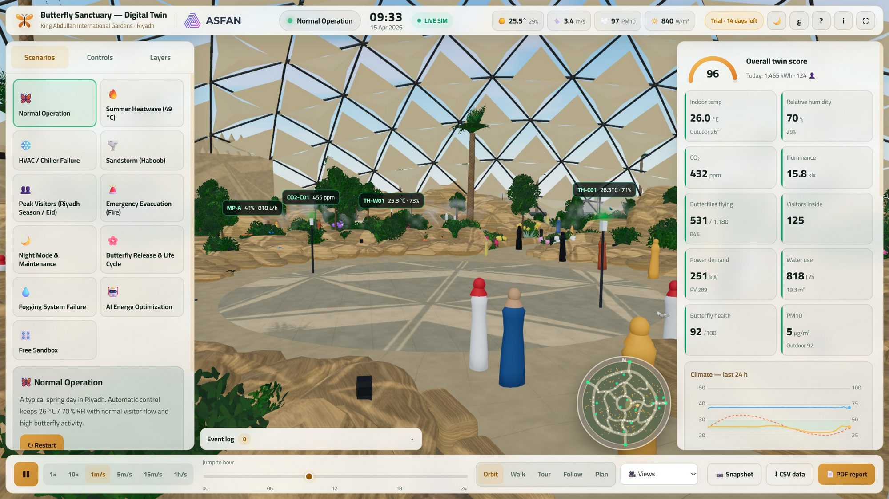

<h1 align="center">KAIG Butterfly Sanctuary — Digital Twin التوأم الرقمي لمحمية الفراشات</h1>

King Abdullah International Gardens · Riyadh — حدائق الملك عبدالله العالمية · الرياض

## ⬇️ Downloads · التحميل

| File · الملف | Description · الوصف |
|---|---|
| [**KAIG-Butterfly-Twin-Portable-1.0.0.exe**](https://github.com/asfantrading-create/kaig-butterfly-digital-twin/releases/latest/download/KAIG-Butterfly-Twin-Portable-1.0.0.exe) | Portable — runs directly, no installation · نسخة محمولة تعمل مباشرة بدون تثبيت |
| [**KAIG-Butterfly-Twin-Setup-1.0.0.exe**](https://github.com/asfantrading-create/kaig-butterfly-digital-twin/releases/latest/download/KAIG-Butterfly-Twin-Setup-1.0.0.exe) | Full installer (Arabic / English) · مثبّت كامل |
| [**KAIG-Butterfly-Twin-User-Manual.pdf**](https://github.com/asfantrading-create/kaig-butterfly-digital-twin/releases/latest/download/KAIG-Butterfly-Twin-User-Manual.pdf) | User manual (Arabic + English) · دليل المستخدم باللغتين |

All versions: [Releases](https://github.com/asfantrading-create/kaig-butterfly-digital-twin/releases)

> Windows 10/11 (64-bit). If Windows SmartScreen appears, click **More info → Run anyway**.
> عند ظهور رسالة SmartScreen اضغط **مزيد من المعلومات ← تشغيل على أي حال**.

## About · نبذة

An interactive 3D digital twin of the KAIG butterfly dome, coupled to a physics engine for climate, energy, visitors and the butterfly life cycle — with 11 operational scenarios (heatwave, chiller failure, sandstorm, peak visitors, fire evacuation, night mode, butterfly release, fogging failure, AI energy optimisation, sandbox), live IoT sensors, heatmaps, bilingual PDF reports and CSV export.

توأم رقمي تفاعلي ثلاثي الأبعاد لقبة الفراشات، مرتبط بمحرك محاكاة فيزيائي للمناخ والطاقة والزوار ودورة حياة الفراشات، ويتضمن 11 سيناريو تشغيلياً، حساسات IoT حية، خرائط حرارية، تقارير PDF ثنائية اللغة وتصدير CSV.

Includes a 14-day trial · يتضمن فترة تجريبية 14 يوماً.

## Contact · التواصل

**ASFAN** — ✉️ info@asfanco.com · 💬 WhatsApp [+962 77 614 0404](https://wa.me/962776140404)

© ASFAN. All rights reserved. جميع الحقوق محفوظة.
